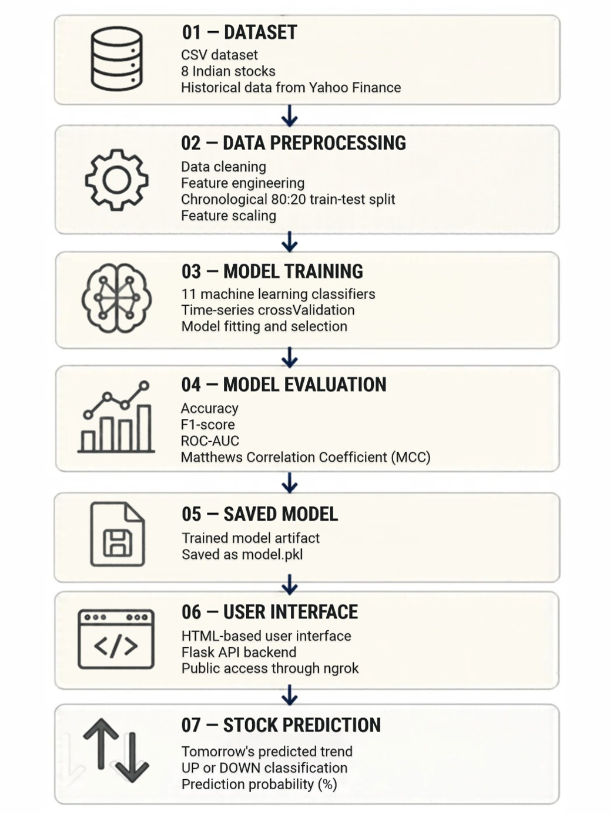
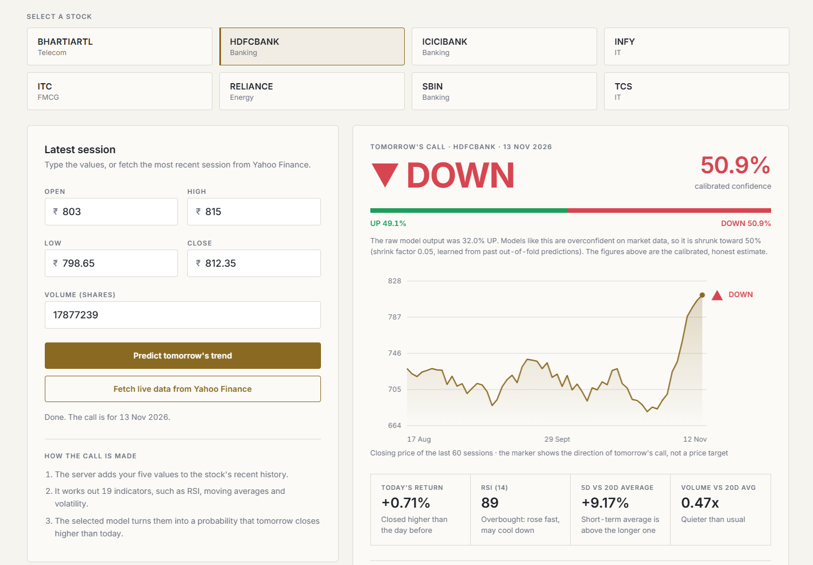
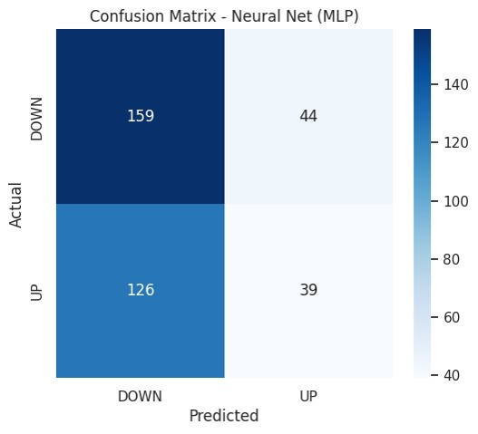
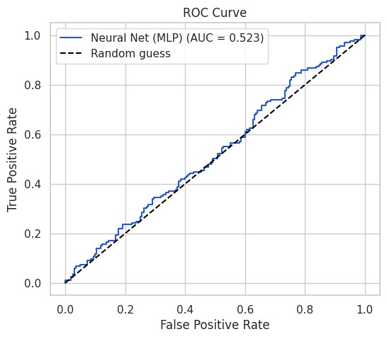

# 📈 Stock Trend Predictor

> Predicting whether an NSE stock will close **UP** or **DOWN** on the next trading day using supervised machine learning, served through a Flask API and a web interface.

[](https://colab.research.google.com/github/jivan-nirmaan/stock-trend-predictor/blob/main/stock_trend_classifier.ipynb)


Final-year project, B.E. Computer Science & Engineering (AI & ML), Chandigarh University, November 2026.

---

## 🎯 Problem

Beginner investors often ask one simple question: *Will this stock go up or down tomorrow?* SEBI studies show that a large majority of individual F&O traders in India make net losses, so a careful, data-based way of reading trends is useful. This project builds a binary classifier for next-day direction and wraps it in a simple web app.

## 📊 Dataset

- **Source:** Yahoo Finance API (via the `yfinance` Python library)
- **Stocks (8 NSE):** TCS, INFY, HDFCBANK, ICICIBANK, SBIN, RELIANCE, ITC, BHARTIARTL
- **Size:** 1,984 daily OHLCV records covering one year (`indian_stocks_real.csv`)
- **Target:** `1` if tomorrow's close > today's close, else `0`

## 🔧 Approach

1. **Cleaning and validation:** duplicates, missing values and OHLC logic checks
2. **Feature engineering:** 19 technical features computed from past data only (returns, moving averages, RSI, MACD, Bollinger Bands, ATR, volatility, volume ratios)
3. **Chronological 80:20 split by date** (no random split, so there is no future leakage)
4. **Outlier clipping and scaling** fitted on training data only
5. **11 classifiers compared** (Logistic Regression, KNN, Naive Bayes, Decision Tree, Random Forest, Extra Trees, Gradient Boosting, AdaBoost, SVM, MLP, XGBoost, LightGBM) against a majority-class baseline using `TimeSeriesSplit` cross-validation
6. **Models are tuned** with `RandomizedSearchCV`, final model picked by cross-validated ROC-AUC (not test accuracy)
7. **Probability calibration** (temperature scaling) so the confidence shown to the user is honest
8. **Flask API + HTML interface** with live data fetch from Yahoo Finance

## 🏆 Results

| Metric | Selected model (tuned MLP) | Majority baseline |
|---|---|---|
| Test accuracy | 53.8% | 55.2% |
| Test ROC-AUC | 0.52 | 0.50 |
| Test MCC | 0.02 | 0.00 |
| CV ROC-AUC | 0.54 | 0.50 |

**Honest finding:** with strict time-based splitting and no leakage, next-day stock direction is very hard to predict from past prices alone. The model performs close to random guessing. The value of this project is the complete, leak-free pipeline, the fair model comparison and the working interface.

## 🏗️ System Architecture

<p align="center">
  
</p>

---

## 💻 Web Application Preview

<p align="center">
  
</p>

---

## 📊 Model Evaluation

| Confusion Matrix | ROC Curve |
| :---: | :---: |
|  |  |
| *Next-day direction classification on NSE test split* | *AUC score across 8 large-cap Indian stocks* |

## 📁 Repository structure

```
stock-trend-predictor/
├── stock_trend_classifier.ipynb   # Colab notebook: EDA, training, Flask API
├── stock_predictor_page.html      # Web interface
├── indian_stocks_real.csv         # Dataset
├── requirements.txt               # Python dependencies
├── images/                        # Screenshots used in this README
└── README.md
```

## 🚀 How to run

The backend runs in Google Colab and the web page connects to it through an ngrok link.

1. Open `stock_trend_classifier.ipynb` in [Google Colab](https://colab.research.google.com) (use the badge above, or **File → Upload notebook**).
2. Upload `indian_stocks_real.csv` using the folder icon on the left of Colab.
3. Create a free account at [ngrok](https://dashboard.ngrok.com) and copy your **authtoken**.
4. In the last code cell, paste it into `NGROK_TOKEN = ""`. **Never commit or share your token.**
5. Click **Runtime → Run all**. Wait a few minutes. The last cell keeps running because it is the server.
6. Copy the printed ngrok URL.
7. Open `stock_predictor_page.html` in your browser, paste the URL into **Backend URL** and click **Connect**.
8. Pick a stock, type or fetch the latest Open/High/Low/Close/Volume, and click **Predict tomorrow's trend**.


## 🛠️ Tech stack

Python, pandas, NumPy, scikit-learn, XGBoost, LightGBM, matplotlib, seaborn, Plotly, joblib, yfinance, Flask, Flask-CORS, pyngrok, HTML/CSS/JavaScript, Google Colab.

## 🔮 Future work

- Use several years of data and more stocks
- Add NIFTY index movement, news sentiment and company results as features
- Deploy the API and page on a free cloud service (no Colab or ngrok needed)
- Add alerts and a watchlist

## 👤 Author

**Jivanjot Singh** | [LinkedIn](https://linkedin.com/in/jivan-nirmaan) | [GitHub](https://github.com/jivan-nirmaan)

Built a project for B.E. CSE (AI & ML), Chandigarh University, 2026.


## ⚠️ Disclaimer

This is an educational project. Predictions are **not financial advice**. Do not make real trading decisions based on this model.

## 📄 License

Released under the MIT License.
